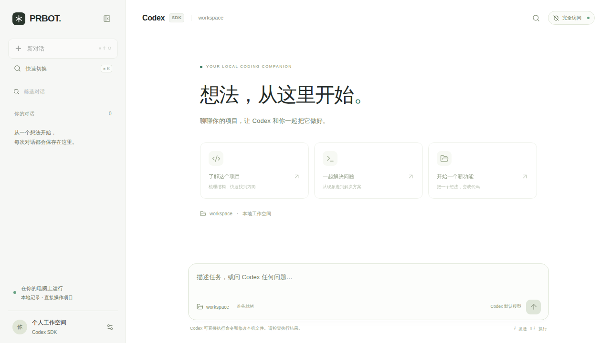

# PRBOT

一个在本机运行的 Codex 对话工作台。使用 TypeScript、Next.js App Router、React、Tailwind CSS 和官方 `@openai/codex-sdk`，界面参考 ChatGPT 的侧栏、聊天流和底部输入框。

支持新建/搜索/删除历史对话、连续上下文、刷新后恢复、Markdown 与代码块、复制回复、流式执行反馈、文件修改记录、停止生成，以及桌面和手机尺寸布局。

**按用户要求，Codex 以 `danger-full-access` + `approvalPolicy: never` 运行，可以直接读写本机文件、执行命令、访问网络。** 页面始终显示“完全访问”。项目目录只是起始工作目录，不是文件系统边界；停止不会撤销已完成操作。应用仅供本机单人使用，默认监听 `127.0.0.1`，不要改成公网服务。



[查看手机对话界面](docs/screenshots/mobile.png)。截图使用 CI 测试替身，不含真实用户会话。

## 使用

安装 Node.js **24.22.1 或更新的受支持安全版本**（仓库 `.node-version` 固定了当前 LTS 安全版）。

```sh
npm ci --ignore-scripts
cp .env.example .env.local
```

编辑 `.env.local`：

```dotenv
CODEX_WORKSPACE=/你的项目绝对路径
# 可选，留空则使用本机 Codex 配置的默认模型
CODEX_MODEL=
```

认证有两种方式，任选一种：

- 已经使用 Codex CLI：在同一个系统账户下完成 `codex login`，应用复用本机登录；SDK 自带运行所需的 CLI。
- API key：在 `.env.local` 设置 `CODEX_API_KEY`，也兼容服务端 `OPENAI_API_KEY`。密钥不得使用 `NEXT_PUBLIC_` 前缀。

SDK 的依赖已经提供 CLI，可直接登录：

```sh
./node_modules/.bin/codex login
```

启动：

```sh
npm run dev
```

浏览器访问 <http://127.0.0.1:3000>。先在“工作空间”中核对目录，然后发送任务。Enter 发送，Shift + Enter 换行；中文输入法选字不会误发送。点击执行过程可查看命令输出、文件变更和工具状态。

生产模式启动命令（构建按本仓库约定交给远端 CI）：

```sh
npm run start
```

`npm run start` 需要相同系统平台上已有的 `.next` 构建产物；干净源码请使用开发模式，或由你的远端构建/交付流程准备产物。本次交付没有在本地运行开发服务、构建或测试。

## 交互细节

参考维护活跃、MIT 许可的 Motion 与 shadcn/assistant-ui，采用克制精致的聊天工作台设计。具体来源与上游问题调查见 [高级交互研究](docs/interaction-research.md)。

- 欢迎卡片、消息首次出现、按钮按压和提示使用 Motion 14.6.0；流式文本不会反复重播动画。
- `⌘ / Ctrl + K` 打开快速切换，搜索历史或启动新对话；`⌘ / Ctrl + Shift + O` 新建对话。弹窗支持 Tab / Enter、Esc 和焦点返回。
- 桌面侧栏可收起并记住选择；手机保留独立抽屉与关闭入口。
- 输入框随内容增高，生成期间可以先写下一条；草稿按对话保存在当前浏览器，刷新或切换后仍可接着写。清除浏览器存储会删除草稿；存储不可用时只保留输入框中的内容。
- 向上阅读时不抢滚动；“回到最新消息”浮在输入框上方，不挤压阅读区域。执行过程手动折叠后保持选择。
- 删除有应用内确认与完成反馈；系统“减少动态效果”的变化会即时生效。

## 配置与数据

| 服务端变量 | 用途 |
| --- | --- |
| `CODEX_WORKSPACE` | 起始项目目录，留空使用程序仓库目录；必须存在 |
| `CODEX_MODEL` | 指定账户有权限使用的模型；留空采用 Codex 默认，不硬编码模型清单 |
| `CODEX_API_KEY` / `OPENAI_API_KEY` | 可选 API key，留空复用本机 Codex 登录 |
| `CODEX_PATH_OVERRIDE` | 可选，使用你指定的官方 Codex CLI 可执行文件 |
| `PRBOT_DATA_DIR` | 聊天记录目录，默认 `.data` |

项目内没有已有 `.env`；已检查上级 `.env` 只有 Infisical 配置，与本应用认证无关，因此未复制任何凭据。修改配置后重启；切换项目目录时新建对话，避免把不同项目的上下文混在一起。

聊天正文保存在 `.data/<uuid>.json`，Codex 自身会话按 SDK 规则保存在本机 Codex 会话目录。删除聊天只删除本程序记录，不删除 Codex 会话或回滚项目。服务重启后打开历史对话即可继续；中断的回复会标为已停止。同一对话只允许一个执行，期间禁止切换/删除；其他浏览器打开正在执行的对话时会轮询最新状态并可停止。请只运行一个 Node 服务进程，不支持多实例或多用户。

## 验证与依赖安全

验证由 [GitHub Actions](https://github.com/C0verSnow/PRBOT1/actions/workflows/ci.yml) 执行：

1. `npm ci --ignore-scripts` 按完整 lockfile 安装；禁止依赖安装脚本。
2. `npm audit --audit-level=high` 审计全部依赖，发现 high / critical 即失败。
3. TypeScript 静态类型检查、Vitest 生命周期/存储/边界测试、Next.js 生产构建。
4. Playwright 桌面/手机测试：浏览器 → API → **真实 SDK 子进程接口** → CI 临时目录文件写入；覆盖连续对话、刷新恢复、失败、停止后继续、执行记录和截图。

CI 的 Codex CLI 使用 `scripts/fake-codex.mjs` 确定性测试替身，不连接付费模型，也不使用用户密钥。正常运行不启用替身。真实模型推理、账户权限和具体项目修改需使用你自己的本机登录体验；不能把替身测试当成真实模型验收。

直接依赖精确锁定，lockfile 包含完整性哈希；`.npmrc` 默认关闭依赖安装脚本；Dependabot 每天检查 npm 更新，每周检查 Actions 更新。已核对近期 Next.js、React RSC 与 Node 安全公告，详细记录见 [设计与安全说明](docs/design.md)。`npm audit` 无法保证没有未知漏洞或恶意包，依赖升级仍需看差异和远端 CI。

最终功能提交 `9dde9ba` 已通过 [远端完整验证](https://github.com/C0verSnow/PRBOT1/actions/runs/40274299202)：**32 个单元测试 + 4 个桌面/手机浏览器测试通过**，类型检查、生产构建和依赖审计通过，已知漏洞 0 个。[完整报告与截图下载](https://github.com/C0verSnow/PRBOT1/actions/runs/40274299202/artifacts/12629781857)。

## 文档

- [设计、开源方案比较与安全公告](docs/design.md)
- [带 Unix Timestamp 的执行记录](tasklist.md)
- [Codex SDK 官方文档](https://developers.openai.com/codex/sdk/)
